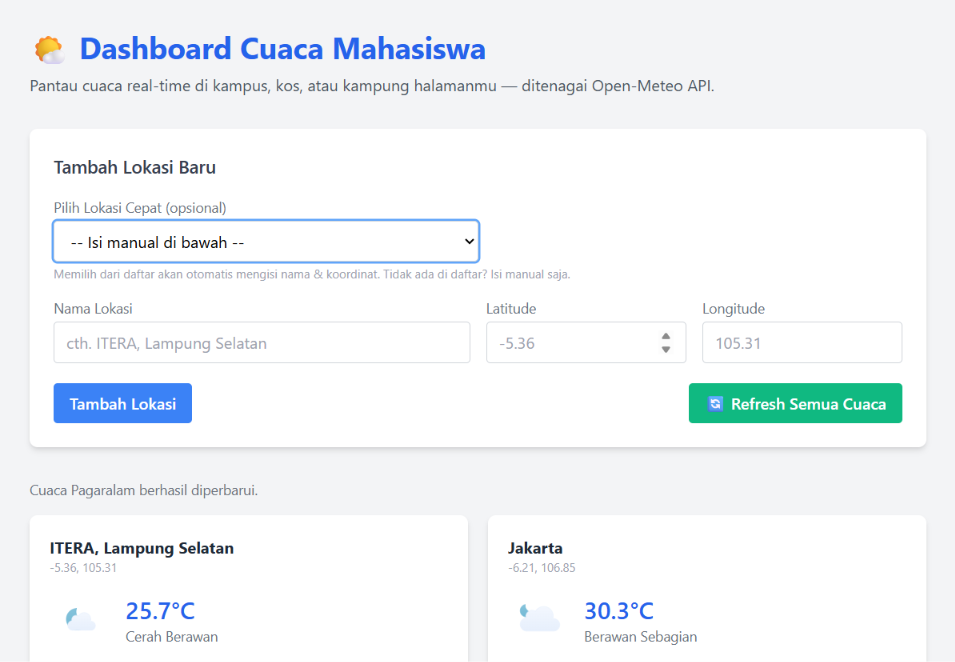

# Dashboard Cuaca Mahasiswa 🌤️

Tugas Praktikum — Pertemuan 2: JavaScript Next Gen (ES6+)
Teknik Informatika · ITERA

## 1. Deskripsi Aplikasi

**Dashboard Cuaca Mahasiswa** adalah aplikasi single-page sederhana yang
menampilkan **informasi cuaca real-time** untuk beberapa lokasi pilihan
pengguna (misalnya kampus, kos, atau kampung halaman), dengan data yang
diambil langsung dari API publik **Open-Meteo** (tanpa API key).

### Fitur Utama

- 📍 **Pilih lokasi cepat** dari dropdown preset (daftar koordinat kota/kampus sudah disiapkan di kode, lihat `js/modules/locationPresets.js`) — tidak perlu cari koordinat manual.
- ➕ **Tambah lokasi** baru dengan nama, latitude, dan longitude (manual, untuk lokasi yang belum ada di preset, misal kos pribadi).
- ✏️ **Edit** nama/koordinat lokasi yang sudah tersimpan.
- 🗑️ **Hapus** lokasi yang tidak diperlukan lagi.
- 🔄 **Refresh** cuaca per-lokasi atau sekaligus untuk semua lokasi.
- 💾 Semua data lokasi **disimpan otomatis di `localStorage`**, sehingga
  tetap ada walau halaman di-refresh atau browser ditutup.
- 🌦️ Data cuaca (suhu, kecepatan angin, kondisi cuaca, waktu update)
  diambil secara **asinkron** dari Open-Meteo API setiap kali lokasi
  ditambah/diedit/direfresh.
- 🎨 Ikon cuaca memakai set ikon **[Meteocons](https://github.com/basmilius/meteocons)**
  — ikon resmi yang direkomendasikan Open-Meteo untuk merepresentasikan kode cuaca WMO,
  dimuat langsung dari CDN jsDelivr (bukan emoji).
- Lokasi default: **ITERA, Lampung Selatan** (-5.36, 105.31).

### Cara Menjalankan

1. Buka folder project ini di VS Code.
2. Klik kanan `index.html` → **Open with Live Server**
   (jangan dibuka langsung via `file://` karena memakai ES Modules).
3. Dashboard akan otomatis memuat cuaca untuk lokasi default saat pertama kali dibuka.

### Screenshot Antarmuka

Tampilan dashboard setelah dijalankan dengan Live Server — menampilkan form
tambah lokasi (lengkap dengan dropdown preset), pesan status, dan kartu cuaca
untuk ITERA & Jakarta yang sudah menampilkan suhu, ikon cuaca, dan kondisi
real-time dari Open-Meteo:



## 2. Daftar Fitur ES6+ yang Diimplementasikan

| Fitur ES6+ | Lokasi File & Baris |
| --- | --- |
| **`const`** | Dipakai untuk semua nilai yang tidak berubah: `js/classes/WeatherDashboardApp.js:8-12` (`STORAGE_KEY`, `DEFAULT_LOCATIONS`), `js/main.js:13-23` (referensi elemen DOM), dll. |
| **`let`** | Dipakai saat nilai memang perlu berubah (reassignment): `js/modules/weatherApi.js:20-21` (`attempt`, `lastError` pada mekanisme retry fetch cuaca) — `attempt` bertambah tiap percobaan (`:24`), `lastError` diperbarui tiap gagal (`:35`) |
| **Arrow Functions** (≥3) | `js/modules/utils.js:45-49` (`describeWeatherCode`), `js/modules/utils.js:52-62` (`formatDateTime`), `js/modules/utils.js:65-66` (`generateId`), `js/modules/utils.js:69` (`formatCoordinate`), `js/modules/weatherApi.js:17` (`fetchCurrentWeather`), serta `js/main.js:47-54` (`resetForm`), `js/main.js:57-66` (`fillFormForEdit`) |
| **Template Literals** | `js/classes/WeatherDashboardApp.js:80` (pesan status), `js/classes/WeatherDashboardApp.js:124-166` (`renderCard` — seluruh markup kartu cuaca dirender dengan template literal), `js/modules/weatherApi.js:18` (membangun URL API) |
| **Destructuring** | Parameter fungsi: `js/classes/WeatherDashboardApp.js:16` (`constructor`), `:46` (`addLocation`), `:54` (`updateLocationInfo`), `:83-86` & `:121-122` (`refreshLocationWeather`, `renderCard`); `js/modules/weatherApi.js:17` (`{ latitude, longitude }`) |
| **Spread Operator** | `js/classes/WeatherDashboardApp.js:48` (`[...this.locations, newLocation]` — immutable update array), `js/classes/WeatherDashboardApp.js:56` (`{ ...loc, name, latitude, longitude }`), `js/classes/LocationItem.js:17-21` (`withWeather`) |
| **Classes** | `js/classes/LocationItem.js` (model data lokasi), `js/classes/WeatherDashboardApp.js` (pengelola state, localStorage, dan pemanggilan API) |
| **Modules (`import`/`export`)** | Semua file di `js/modules/` dan `js/classes/` menggunakan `export`, diimpor kembali di `js/classes/WeatherDashboardApp.js:4-6` dan `js/main.js:4-5` |
| **Modern Array Methods** | `.map()` di `js/classes/WeatherDashboardApp.js:28, 32, 40, 55, 88, 103, 172`, `.filter()` di `:64`, `.find()` di `:70` |
| **Async/Await + Fetch + Retry** | `js/modules/weatherApi.js:17-41` (`fetchCurrentWeather`, dengan retry via `while` + `let attempt`), dipanggil dengan `await` di `js/classes/WeatherDashboardApp.js:83` dan dikombinasikan dengan `Promise.all()` di `:101-106` (`refreshAllWeather`) |
| **Optional Chaining (`?.`) & Nullish Coalescing (`??`)** | `js/modules/utils.js:46` (`?? FALLBACK_WEATHER`), `js/classes/WeatherDashboardApp.js:122` (`weather?.weathercode`, `weather?.is_day`), `js/classes/WeatherDashboardApp.js:115-117` (`this.gridEl?.querySelector`) |

## 3. Lokasi Preset (Tanpa Perlu Cari Koordinat Manual)

Agar pengguna tidak perlu mencari latitude/longitude sendiri, disediakan daftar
lokasi siap pakai di `js/modules/locationPresets.js` (array `LOCATION_PRESETS`).
Daftar ini otomatis mengisi dropdown **"Pilih Lokasi Cepat"** di form
(`js/main.js:25-33`), dan saat dipilih akan mengisi nama + koordinat ke form
secara otomatis (`js/main.js:35-44`). Untuk lokasi yang belum ada di daftar
(misalnya kos pribadi), pengguna tetap bisa mengisi manual atau menambah
entri baru langsung di `locationPresets.js`.

## 4. Struktur Proyek

```
dashboard-cuaca-itera/
├── index.html
├── css/
│   └── style.css
├── js/
│   ├── main.js
│   ├── classes/
│   │   ├── LocationItem.js
│   │   └── WeatherDashboardApp.js
│   └── modules/
│       ├── utils.js
│       ├── locationPresets.js
│       └── weatherApi.js
└── README.md
```

## 5. Sumber Data

- **Open-Meteo Current Weather API** — `https://api.open-meteo.com/v1/forecast?latitude={lat}&longitude={lon}&current_weather=true`
  (gratis, tanpa API key).
- **Meteocons (ikon cuaca)** — `https://cdn.jsdelivr.net/npm/@meteocons/svg@0.1.0/fill/{slug}.svg`,
  ikon SVG resmi yang direkomendasikan di dokumentasi Open-Meteo, dipetakan dari
  kode cuaca WMO + status siang/malam (`is_day`) di `js/modules/utils.js:40-45`.
